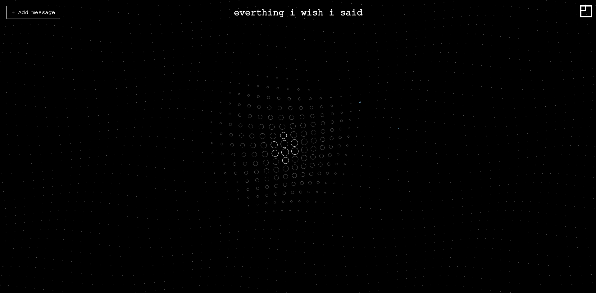
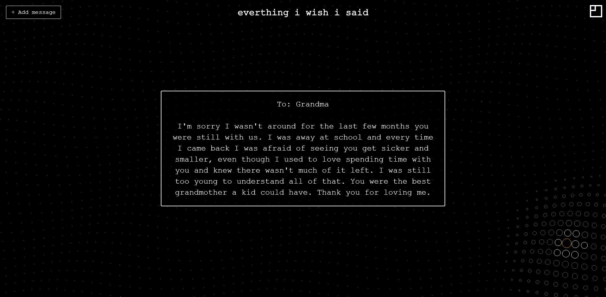
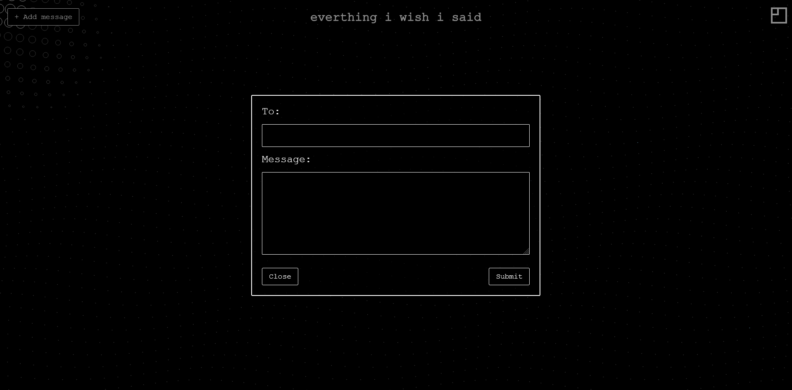

# Everything I Wish I Said

An interactive space for messages to people we miss, cannot reach, or never found the words to speak to.

Developed from the concept **Querying the Map**, this project invites visitors to explore a field of animated waves and discover messages hidden among their movement. Visitors can also contribute their own messages, allowing them to get lost and added to the shared, anonymous collection.

The project explores how an interface can create space for reflection, connection, and catharsis through writing and discovery.

[Live Site](https://ewspublic.vercel.app/)

## Experience

- Move your cursor across the circles to discover messages and their recipients.
- Select **Add a message** to open the submission form.
- Enter a recipient and message, then submit to add it to the collection.
- Hover over the information icon to learn about the project.

Messages are publicly visible. Recipient names are supplied by visitors; the site does not deliver messages to those people.

## Features

- Animated circle field built with p5.js.
- Random message placement without reusing the same database entry within a grid.
- Responsive HTML message boxes that wrap text and scroll for longer entries.
- A centered submission form with validation and submission feedback.
- Persistent message storage in Supabase, replacing the original CSV source.
- Canvas resizing and grid rebuilding when the browser size changes.

## Built with

- **p5.js** — canvas animation and spatial interaction.
- **JavaScript** — message loading, interaction, and form handling.
- **HTML and CSS** — responsive overlays and submission interface.
- **Supabase / PostgreSQL** — message storage and access policies.
